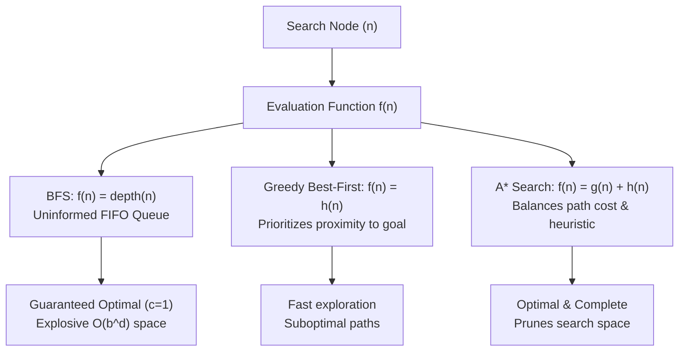

# 🧩 8-Puzzle Solver & Academic Search Benchmark

[](https://www.python.org/)
[](https://opensource.org/licenses/MIT)
[]()
[]()
[-brightgreen.svg)]()

A production-grade, academically rigorous implementation and benchmark of uninformed and heuristic search strategies for the classical **8-Puzzle problem**.

Designed to align directly with university **Artificial Intelligence (AI)** coursework (Russell & Norvig, *Artificial Intelligence: A Modern Approach*), this project provides formal problem formulation, rigorous mathematical proofs (admissibility, consistency, dominance, solvability invariants), modular code architecture, high-precision performance metrics, and an interactive terminal CLI with step-by-step state animations.

---

## 📑 Table of Contents

- [Problem Formulation (5-Tuple)](#-problem-formulation-5-tuple)
- [Theoretical Background](#-theoretical-background)
  - [Search Strategies](#search-strategies)
  - [Heuristic Functions](#heuristic-functions)
  - [Mathematical Proofs](#mathematical-proofs)
  - [Solvability & Inversion Invariant](#solvability--inversion-invariant)
- [Experimental Benchmark Results](#-experimental-benchmark-results)
- [Project Architecture](#-project-architecture)
- [Installation & Quickstart](#-installation--quickstart)
- [Usage Guide & CLI Options](#-usage-guide--cli-options)
- [Running Automated Tests](#-running-automated-tests)
- [Academic Insights & Discussion](#-academic-insights--discussion)

---

## 🎯 Problem Formulation (5-Tuple)

Following the standard Russell & Norvig problem formulation framework, the 8-puzzle is formalized as the 5-tuple $\langle S_0, A, T, G, c \rangle$:

| Component | Formal Definition | Implementation in Project |
| :--- | :--- | :--- |
| **Initial State ($S_0$)** | A specific permutation of $\{0, 1, \dots, 8\}$ on a $3 \times 3$ grid, where $0$ represents the blank space. | `State = tuple[int, ...]` of length 9 |
| **Actions ($A(s)$)** | Moving the **blank tile ($0$)** in one of four cardinal directions: $\{\text{UP}, \text{DOWN}, \text{LEFT}, \text{RIGHT}\}$, constrained by grid boundaries. | `src/puzzle.py: get_successors()` |
| **Transition Model ($T(s, a)$)** | Returns the state $s'$ resulting from swapping the blank tile with the adjacent tile in direction $a$. | `src/puzzle.py: apply_action()` |
| **Goal Test ($G(s)$)** | Checks whether state $s$ exactly matches the canonical goal state: $s = (1, 2, 3, 4, 5, 6, 7, 8, 0)$. | `state == GOAL_STATE` |
| **Path Cost ($c(s, a, s')$)** | Unit step cost: $c(s, a, s') = 1$ for every transition. Path cost $g(n)$ equals the solution depth $d$. | `Node.g = parent.g + 1` |

```
Canonical Goal State Layout:
┌───┬───┬───┐
│ 1 │ 2 │ 3 │
├───┼───┼───┤
│ 4 │ 5 │ 6 │
├───┼───┼───┤
│ 7 │ 8 │   │  (0 represents the blank tile at index 8)
└───┴───┴───┘
```

---

## 🧠 Theoretical Background

### Search Strategies



1. **Breadth-First Search (BFS)**:
   - **Strategy**: Explores the state space layer by layer in FIFO order.
   - **Evaluation**: Equivalent to uniform-cost search with $f(n) = g(n) = \text{depth}(n)$.
   - **Properties**: Complete and guaranteed to return an optimal path for uniform step costs. However, it suffers from $O(b^d)$ time and memory complexity, where $b \approx 3$ is the average branching factor.
   - **Implementation**: Utilizes `collections.deque` with an early goal test upon generation (Section 3.4.1, Russell & Norvig).

2. **Greedy Best-First Search**:
   - **Strategy**: Prioritizes the node that appears closest to the goal.
   - **Evaluation**: $f(n) = h(n)$.
   - **Properties**: Complete in finite graphs with closed-list cycle pruning, but **not optimal**. Greedy search ignores the accumulated path cost $g(n)$, often making short-sighted moves that lead to long, detour-filled solution paths.

3. **A\* Search**:
   - **Strategy**: Combines the verified past path cost $g(n)$ with the estimated future cost $h(n)$.
   - **Evaluation**: $f(n) = g(n) + h(n)$.
   - **Properties**:
     - **Tree Search**: Optimal if $h(n)$ is admissible ($0 \le h(n) \le h^*(n)$).
     - **Graph Search**: Optimal without node re-opening if $h(n)$ is consistent (monotone).

---

### Heuristic Functions

#### 1. Misplaced Tiles ($h_1$ - Hamming Distance)
Counts the number of non-blank tiles ($t \in \{1, \dots, 8\}$) that do not occupy their goal coordinate:

$$h_1(n) = \sum_{t=1}^{8} \mathbf{1}_{[\text{pos}_n(t) \neq \text{pos}_{\text{goal}}(t)]}$$

> **Note**: In accordance with academic convention, the blank tile ($0$) is excluded from the count.

#### 2. Manhattan Distance ($h_2$ - Taxicab / $L_1$ Norm)
Computes the sum of horizontal and vertical distances of each non-blank tile from its designated goal position:

$$h_2(n) = \sum_{t=1}^{8} \left( |r_n(t) - r_{\text{goal}}(t)| + |c_n(t) - c_{\text{goal}}(t)| \right)$$

where $(r_n(t), c_n(t))$ and $(r_{\text{goal}}(t), c_{\text{goal}}(t))$ are the row and column coordinates of tile $t$ in state $n$ and the goal state, respectively.

---

### Mathematical Proofs

#### Theorem 1: Admissibility of $h_1$ and $h_2$
A heuristic $h(n)$ is admissible if $0 \le h(n) \le h^*(n)$ for all states $n$, where $h^*(n)$ is the true optimal cost to reach the goal.

* **Proof for $h_1$**: A single move transitions at most one non-blank tile into an adjacent cell. Therefore, one move can correct the position of at most one misplaced tile. If $k$ tiles are misplaced, at least $k$ separate moves are required to reach the goal. Hence, $h_1(n) \le h^*(n)$. $\blacksquare$
* **Proof for $h_2$**: Consider a relaxed version of the 8-puzzle where tiles can pass through one another (ignoring occupancy constraints). In this relaxed graph, the minimum number of single-step moves needed to slide tile $t$ to its target coordinate is its Manhattan distance $|r_n(t) - r_{\text{goal}}(t)| + |c_n(t) - c_{\text{goal}}(t)|$. Because relaxing problem constraints can never increase the optimal path cost, the sum of Manhattan distances is a lower bound on the true constrained cost: $h_2(n) \le h^*(n)$. $\blacksquare$

#### Theorem 2: Consistency (Monotonicity)
A heuristic $h(n)$ is consistent if for every state $n$ and successor $n'$ generated by action $a$:

$$h(n) \le c(n, a, n') + h(n') = 1 + h(n')$$

* In any transition $(n, a, n')$, exactly one non-blank tile slides into the empty space by 1 coordinate step.
* For $h_1$: The moved tile can either enter its goal position ($\Delta h_1 = -1$), leave its goal position ($\Delta h_1 = +1$), or move between two non-goal positions ($\Delta h_1 = 0$). Thus, $|h_1(n) - h_1(n')| \le 1$.
* For $h_2$: The moved tile changes its Manhattan distance to its goal by either $+1$ or $-1$, while all other non-blank tiles remain stationary. Thus, $|h_2(n) - h_2(n')| \le 1$.
* Both heuristics satisfy the triangle inequality $h(n) - h(n') \le 1 \iff h(n) \le 1 + h(n')$. $\blacksquare$

#### Theorem 3: Heuristic Dominance ($h_2$ dominates $h_1$)
For any two admissible heuristics $h_a$ and $h_b$, $h_a$ **dominates** $h_b$ if for all states $n$:

$$h_a(n) \ge h_b(n)$$

* **Proof**: Let $t \in \{1, \dots, 8\}$.
  - If tile $t$ is in its goal position: its contribution to $h_1$ is $0$, and its contribution to $h_2$ is $|0| + |0| = 0$.
  - If tile $t$ is misplaced: its contribution to $h_1$ is $1$. Because its position differs from the goal, it must differ in row, column, or both. Since coordinates are integers:
    $$|r_n(t) - r_{\text{goal}}(t)| + |c_n(t) - c_{\text{goal}}(t)| \ge 1$$
  - Summing over all non-blank tiles:
    $$h_2(n) = \sum_{t=1}^8 \text{dist}_{\text{Manhattan}}(t) \ge \sum_{t=1}^8 \mathbf{1}_{[\text{misplaced}(t)]} = h_1(n)$$
* **Corollary**: By Russell & Norvig Theorem 3.6, A\* using a dominating consistent heuristic $h_2$ is guaranteed to expand a subset of the nodes expanded by A\* using $h_1$ (subject to tie-breaking on the contour $f(n) = C^*$). $\blacksquare$

---

### Solvability & Inversion Invariant

An arbitrary permutation of the 9 tiles is **not** guaranteed to be solvable. Exactly half ($9! / 2 = 181,440$) of all possible $362,880$ configurations are solvable.

#### Definition: Inversions
For a linearized 9-tuple representing the board, ignoring the blank tile ($0$), an **inversion** is a pair of tiles $(a, b)$ such that $a$ precedes $b$ in the array, but $a > b$:

$$\text{Inversions}(s) = \sum_{i < j, s[i] \neq 0, s[j] \neq 0} \mathbf{1}_{[s[i] > s[j]]}$$

#### Solvability Rule for $3 \times 3$ (Odd Grid Width $N=3$):
1. **Horizontal Move (LEFT / RIGHT)**: The blank tile swaps with a tile immediately preceding or following it in the array. This alters the blank's index by $\pm 1$, leaving the relative ordering of all non-blank tiles completely unchanged. $\Delta \text{Inversions} = 0$.
2. **Vertical Move (UP / DOWN)**: The blank tile moves up or down one row, shifting its index by $\pm 3$. This moves one tile over exactly two non-blank tiles. Passing over two tiles can alter the inversion count by $+2$, $-2$, or $0$.
3. **Parity Invariant**: Under all legal moves, the inversion count changes strictly by an even number:

$$\Delta \text{Inversions} \equiv 0 \pmod 2$$

Since the canonical goal state $(1, 2, 3, 4, 5, 6, 7, 8, 0)$ has $0$ inversions (even parity), **a state is solvable if and only if its inversion count is EVEN**:

$$\text{is\_solvable}(s) \iff \text{Inversions}(s) \equiv 0 \pmod 2$$

Our engine verifies this invariant in $O(N^2)$ time ($36$ operations for 8 tiles), immediately pruning unsolvable configurations before executing search.

---

## 📊 Experimental Benchmark Results

The following empirical results were obtained by running the benchmark suite across curated presets on Python 3.14:

### 1. Easy Preset ($d = 4$)
Initial State: `(1, 5, 2, 4, 0, 3, 7, 8, 6)` | Inversions: 6 (Even, Solvable)

| Algorithm | Heuristic | Path Cost ($d$) | Nodes Expanded | Nodes Generated | Max Frontier | Time (ms) | Optimal? |
| :--- | :--- | :---: | :---: | :---: | :---: | :---: | :---: |
| **BFS** | None (Uninformed) | **4** | 15 | 24 | 9 | 0.05 | **YES** |
| **Greedy** | Misplaced ($h_1$) | **4** | 4 | 10 | 6 | 0.03 | **YES** |
| **Greedy** | Manhattan ($h_2$) | **4** | 4 | 10 | 6 | 0.03 | **YES** |
| **A\*** | Misplaced ($h_1$) | **4** | 4 | 10 | 6 | 0.03 | **YES** |
| **A\*** | Manhattan ($h_2$) | **4** | 4 | 10 | 6 | 0.03 | **YES** |

---

### 2. Medium Preset ($d = 12$)
Initial State: `(5, 8, 2, 1, 7, 3, 0, 4, 6)` | Inversions: 10 (Even, Solvable)

| Algorithm | Heuristic | Path Cost ($d$) | Nodes Expanded | Nodes Generated | Max Frontier | Time (ms) | Optimal? |
| :--- | :--- | :---: | :---: | :---: | :---: | :---: | :---: |
| **BFS** | None (Uninformed) | **12** | 912 | 1,489 | 577 | 1.98 | **YES** |
| **Greedy** | Misplaced ($h_1$) | **42** | 588 | 973 | 385 | 2.05 | <mark>**NO (Suboptimal)**</mark> |
| **Greedy** | Manhattan ($h_2$) | **12** | 12 | 26 | 14 | 0.06 | **YES** |
| **A\*** | Misplaced ($h_1$) | **12** | 56 | 97 | 42 | 0.21 | **YES** |
| **A\*** | Manhattan ($h_2$) | **12** | 12 | 26 | 14 | 0.06 | **YES** |

> 📌 **Key Insight**: Greedy search with $h_1$ took **42 moves** instead of the optimal 12 moves, expanding 588 nodes. Meanwhile, A\*(Manhattan) solved the problem in **12 moves** expanding only **12 nodes**!

---

### 3. Hard Preset ($d = 20$)
Initial State: `(8, 7, 0, 5, 4, 2, 1, 6, 3)` | Inversions: 22 (Even, Solvable)

| Algorithm | Heuristic | Path Cost ($d$) | Nodes Expanded | Nodes Generated | Max Frontier | Time (ms) | Optimal? |
| :--- | :--- | :---: | :---: | :---: | :---: | :---: | :---: |
| **BFS** | None (Uninformed) | **20** | 26,932 | 37,810 | 10,880 | 61.49 | **YES** |
| **Greedy** | Misplaced ($h_1$) | **68** | 385 | 635 | 250 | 1.66 | <mark>**NO (Suboptimal)**</mark> |
| **Greedy** | Manhattan ($h_2$) | **52** | 361 | 598 | 237 | 1.73 | <mark>**NO (Suboptimal)**</mark> |
| **A\*** | Misplaced ($h_1$) | **20** | 2,597 | 4,213 | 1,614 | 11.35 | **YES** |
| **A\*** | Manhattan ($h_2$) | **20** | **91** | **156** | **65** | **0.44** | **YES** |

> 🏆 **Dominance Demonstration**:
> - **A\* ($h_2$) vs A\* ($h_1$)**: Manhattan distance reduced node expansions from **2,597** down to **91** (a **28.5x search space reduction**, 96.5% pruned!).
> - **A\* ($h_2$) vs BFS**: A\* pruned the search space by a factor of **296x** compared to uninformed BFS (91 vs 26,932 expansions).

---

### 4. Unsolvable Preset
Initial State: `(1, 2, 3, 4, 5, 6, 8, 7, 0)` | Inversions: 1 (Odd)

```
[✗] SOLVABILITY STATUS: UNSOLVABLE (PRUNED)
    Mathematical Proof: Every legal move modifies the inversion count by 0, +2, or -2.
    Parity is strictly invariant. State parity = 1 (Odd), Goal parity = 0 (Even).
    Result: 0 nodes expanded, 0.00 ms execution time.
```

---

## 🏗️ Project Architecture

```
project_ai/
├── src/
│   ├── __init__.py           # Package exports & public API
│   ├── puzzle.py             # 5-tuple formulation, Node class, invariants, transitions
│   ├── heuristics.py         # Misplaced tiles (h1) and Manhattan distance (h2)
│   └── search.py             # A*, Greedy Best-First, BFS, SearchResult dataclass
├── tests/
│   ├── __init__.py
│   ├── test_puzzle.py        # Node tie-breaking, actions, boundaries, solvability tests
│   ├── test_heuristics.py    # Admissibility, consistency, dominance property tests
│   └── test_search.py        # Search optimality, path validity, tuple unpacking
├── main.py                   # Interactive CLI, ASCII table benchmarks, path animator
├── requirements.txt          # Minimal dependencies (tabulate, pytest)
└── README.md                 # Academic report and documentation
```

### Key Implementation Highlights:
- **`src/puzzle.py`**:
  - Implements immutable state tuples `tuple[int, ...]` for $O(1)$ hashing and zero-copy lookups.
  - Custom `Node.__lt__` comparison implements multi-tier tie-breaking:
    1. Primary: Minimum evaluation value $f$.
    2. Secondary: Minimum heuristic $h$ (deep dive towards goal).
    3. Tertiary: Deterministic insertion order counter `creation_id`.
- **`src/heuristics.py`**:
  - Precomputes 2D coordinate lookups for the canonical goal layout, delivering sub-microsecond heuristic evaluations without dictionary overhead.
- **`src/search.py`**:
  - `SearchResult` implements standard dataclass metrics while supporting Python tuple unpacking `path, nodes_expanded, elapsed_time = a_star_search(...)`.

---

## 🚀 Installation & Quickstart

### Prerequisites
- Python 3.8 or higher.

### 1. Clone or Open Workspace
```bash
cd project_ai
```

### 2. Install Dependencies
Dependencies are strictly minimal. The core engine runs on pure Python standard library; `tabulate` provides polished terminal grids, and `pytest` runs the unit tests:
```bash
pip install -r requirements.txt
```

---

## 💻 Usage Guide & CLI Options

The CLI application supports both rich interactive menu navigation and direct command-line arguments:

### 1. Launch Interactive Menu
Run without arguments to enter the interactive shell:
```bash
python main.py
```

### 2. Run Presets via CLI
```bash
# Run Easy preset (d=4)
python main.py --preset easy

# Run Medium preset (d=12) with full solution path printout
python main.py --preset medium --solution

# Run Hard preset (d=20) with terminal step animation
python main.py --preset hard --animate --delay 0.25

# Test the Solvability Invariant on an unsolvable board
python main.py --preset unsolvable
```

### 3. Run a Custom Board
Provide any permutation of 0 through 8 as a quoted string:
```bash
python main.py --custom "1 5 2 4 0 3 7 8 6" --solution
```

### 4. Benchmark All Presets Sequentially
```bash
python main.py --all-presets
```

### CLI Flag Reference
| Flag | Description |
| :--- | :--- |
| `-p`, `--preset` | Select a preset: `easy`, `medium`, `hard`, `unsolvable`. |
| `-c`, `--custom` | Enter custom 9-integer board string (e.g. `"1 5 2 4 0 3 7 8 6"`). |
| `-a`, `--animate` | Automatically animate the optimal solution path in the terminal. |
| `-s`, `--solution` | Print the complete step-by-step board trajectory without delay. |
| `-d`, `--delay` | Animation delay in seconds between moves (default: 0.3s). |
| `--all-presets` | Run benchmark across all presets sequentially. |
| `-i`, `--interactive` | Force interactive menu mode. |

---

## 🧪 Running Automated Tests

A comprehensive unit test suite covering puzzle mechanics, mathematical theorems, and search optimality is included under `tests/`:

```bash
python -m pytest -v
```

### Test Coverage Summary:
- `tests/test_puzzle.py`: Node comparison tie-breaking, valid/illegal actions, boundary checks, inversion parity calculation, input parsing.
- `tests/test_heuristics.py`: Blank tile exclusion, goal evaluation, and mathematical dominance theorem verification over 1,000 random board states.
- `tests/test_search.py`: Path legality assertions, BFS optimality, A\* optimality, Greedy suboptimality detection, unsolvable board rejection, and tuple unpacking interface compatibility.

---

## 🎓 Academic Insights & Discussion

1. **Why does Manhattan distance dominate Misplaced tiles?**
   Misplaced tiles only registers a binary flag ($0$ or $1$) for each tile, ignoring how far the tile is from its destination. Manhattan distance quantifies the spatial displacement. Because every misplaced tile is displaced by at least 1 grid unit, $h_2(n) \ge h_1(n)$ holds universally.

2. **Why does Greedy search fail to find the optimal path?**
   Greedy search chooses moves strictly based on $f(n) = h(n)$. In the Medium and Hard presets, Greedy takes tempting moves that decrease $h(n)$ locally but lead into deep topological dead ends, accumulating unnecessary path cost $g(n)$ before recovering.

3. **Space Complexity of BFS vs A\***:
   For depth $d = 20$, BFS maintained over **10,880 nodes** simultaneously in memory on its frontier, generating 37,810 nodes. In contrast, A\*(Manhattan) peaked at a frontier size of only **65 nodes**, requiring orders of magnitude less RAM.

---

## 📜 License

This project is released under the [MIT License](LICENSE). Academic reuse and educational reference are warmly encouraged.

